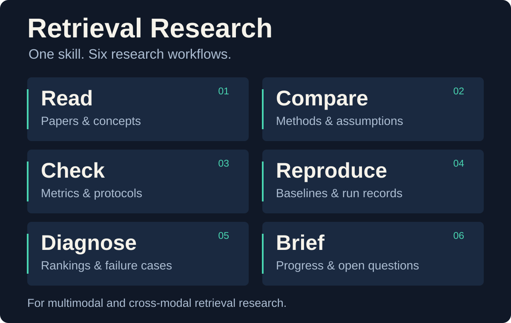
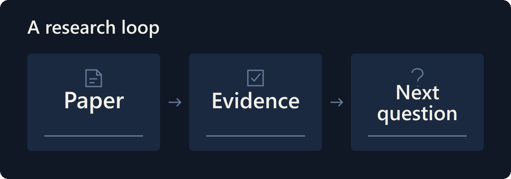

# Retrieval Research

**One Codex skill for multimodal retrieval research, from a paper question to a checkable next experiment.**

<p align="center">
  
</p>

Designed for researchers getting started with cross-modal retrieval. Bring a PDF, a Zotero item, a repository, or retrieval results. Describe what you want to understand or verify; the skill loads only the workflow that helps with that task.

```text
$retrieval-research Read this paper with me. Explain the missing-modality
setting and the core method, then ask me two questions to check my understanding.
```

## What a useful answer looks like

In a small synthetic acceptance exercise, model B improved overall mAP while the **complete-query group got worse**. The workflow retained both findings, the failed run, and the distinction between reported and measured results.

| Synthetic result | Model A | Model B |
| --- | ---: | ---: |
| Overall mAP, 4 queries | 0.645833 | 0.875000 |
| Complete-query group, 2 queries | 0.916667 | 0.750000 |

This is a fixed-distance test of ranking and analysis, **not a trained model or a paper benchmark**. [Inspect the data and rerun it](examples/synthetic-retrieval/README.md).

## Install

Ask Codex:

```text
Install the Codex skill from:
https://github.com/Evan-UNO/retrieval-research/tree/main/skills/retrieval-research
```

Or copy the complete [`skills/retrieval-research`](skills/retrieval-research) folder into `$CODEX_HOME/skills/`. If `CODEX_HOME` is unset, use `~/.codex/skills/`. Preserve any existing local version before replacing it. Only this folder is needed; README assets and examples are optional.

Then start with `$retrieval-research` and your question. Automatic skill selection is also enabled. Instructions are in English; responses follow your language. If a newly installed skill is not visible yet, try the next turn or a new chat.

**Requirements:** Codex with skills support. The two optional helpers use Python 3.9+ and the standard library. Zotero access requires its local API to be available on your machine; a supplied PDF works without Zotero.

## Six workflows, one entry point

| Workflow | Bring | Get |
| --- | --- | --- |
| **Read** | A paper, section, or formula | Source-linked explanations, a paper card when useful, and understanding checks |
| **Compare** | A few papers and a question | Differences in assumptions and mechanisms, comparison limits, and a reading path |
| **Check** | Evaluation code, configurations, or experimental sections | Protocol differences and small, executable metric checks |
| **Reproduce** | A repository, target result, and available data/resources | Actual commands, logs, results, and an honest completion status |
| **Diagnose** | Query/candidate IDs, rankings, positives, and settings | Per-query changes, group differences, and testable explanations |
| **Brief** | Reading notes and experiment records | A research-update outline, evidence, open questions, and oral practice |

<p align="center">
  
</p>

[View the static diagram](assets/readme/workflow.svg). The animation illustrates a workflow; it is not a recording of an experiment.

You can combine workflows:

```text
$retrieval-research Run the smallest viable example in this repository,
compare the two result files, and turn the findings into a three-minute update.
```

Or keep the request small:

```text
$retrieval-research Explain this sign operation and its connection to Hamming
distance. Only cover this formula.
```

## Built around retrieval details

- **Different kinds of incomplete data stay distinct.** Missing modalities, unknown pairings, missing labels, ambiguous candidate labels, and noisy labels are checked against each paper's definitions.
- **A number needs a protocol.** Query/gallery splits, relevance rules, cutoff, bit length, ties, pretraining, and missingness settings affect what can be compared.
- **Evidence keeps its source.** Author-reported results, code inspection, actual execution, and hypotheses are identified separately.
- **Small runs have small claims.** A synthetic example can validate a pipeline. It cannot establish real-data performance, a causal explanation, or successful reproduction of an entire paper.

## Zotero and your research records

```text
$retrieval-research Find the paper I named in my Zotero library and explain
its problem setting before we work through the equations.
```

The included reader uses the local, read-only Zotero API. It can locate items and attachments; it does not modify your library, sync annotations, or infer that you mastered a paper because it was saved or opened. An explicitly selected, consistent backup is an alternative, with its age and source disclosed.

Private PDFs, local paths, library IDs, and experiment logs do not belong in the skill itself. Outputs stay in the conversation unless you request files. If you want a lasting research notebook, provide a workspace and ask Codex to save the paper cards and run records there.

## Check the reusable pieces

From the repository root:

```bash
python skills/retrieval-research/scripts/check_metrics.py --self-test
python skills/retrieval-research/scripts/read_zotero.py --help
```

The metric helper requires explicit choices for AP denominators, cutoff, zero-positive queries, and tie handling. It is a small reference calculator, not a replacement for every paper's evaluator. See the [metric contract](skills/retrieval-research/references/metric-check.md).

For behavior, use the [synthetic task](examples/synthetic-retrieval/task.txt) in a fresh chat without showing the expected answer first. Then verify the saved outputs against the input data. A successful test should preserve the group regression and the limits of the evidence, not merely reproduce a document layout.

The underlying workflows have been exercised on paper comparison and synthetic ranking-analysis-reporting tasks. This public package does not claim that arbitrary training repositories or real-data GPU experiments have been reproduced. [Validation scope](docs/validation.md).

## Repository map

```text
skills/retrieval-research/  Installable skill, references, and two helpers
examples/synthetic-retrieval/  Public, artificial data for repeatable checks
assets/readme/             SVG cards, GIF, and editable motion specification
docs/validation.md         What has been checked and what remains untested
```

To improve a workflow, include a small reproducible example, the expected behavior, and the evidence supporting it. Use synthetic or public material when opening an issue.
